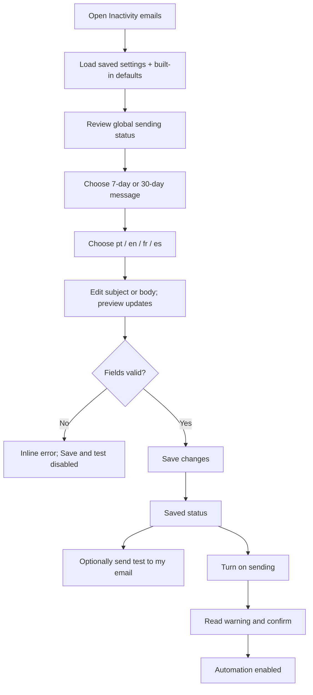

# Inactivity re-engagement emails

**Status:** implementation brief for the admin editor and public unsubscribe page.

## Purpose and send rules

This is a gentle invitation to resume studying, not a warning or a sales
message. There are two messages: after 7 complete days without recorded use,
and after 30 complete days without recorded use. Send each at most once in an
inactivity streak. A new use of the app starts a new streak and makes the
learner eligible again. The automation is off by default.

The send job selects non-blocked, non-admin learners. Before it sends, it must
also exclude learners who have unsubscribed and any learner for whom the
business does not have a recorded, valid basis to send this type of email; see
[Legal/product tension](#legalproduct-tension). It must re-check eligibility at
send time, not just when it builds a batch.

## Template contract

### Owner-editable placeholders

Only these tokens are accepted in a subject or body. Show them as clickable
chips beside every editor, so an admin never has to remember spelling.

| Token | Where allowed | Rendered value / fallback |
| --- | --- | --- |
| `{name}` | Subject and body | Learner's preferred/given name. If missing or blank, render **"there"** in English; **"aí"** in Portuguese; **"là"** in French; **"ahí"** in Spanish. Do not expose an email address as a fallback. |
| `{appUrl}` | Body only, as the button destination | The canonical signed-in MyTCFLab URL. It must be an absolute HTTPS URL generated by the server, never a value entered by the admin. |

The body is plain text with a single primary CTA. The renderer supplies the
button label below and links it to `{appUrl}`; it must not turn an arbitrary
URL pasted into the body into a button. Subjects must not contain line breaks.
No other `{...}` token is valid. Escape template values before HTML rendering.

### Fixed, non-editable footer

The mail renderer appends this footer after the editable body. It is not shown
as a text field and cannot be removed by a reset. `{unsubscribeUrl}`,
`{legalAddress}`, and `{supportEmail}` are system values, not owner-editable
template tokens. The unsubscribe CTA is a normal, prominent link and the URL
must work without signing in.

| Learner locale | Fixed footer |
| --- | --- |
| Portuguese (`pt`) | Você está recebendo este e-mail porque tem uma conta no MyTCFLab. MyTCFLab · `{legalAddress}` · `{supportEmail}`. [Cancelar o recebimento destes e-mails](`{unsubscribeUrl}`) |
| English (`en`) | You are receiving this email because you have a MyTCFLab account. MyTCFLab · `{legalAddress}` · `{supportEmail}`. [Unsubscribe from these emails](`{unsubscribeUrl}`) |
| French (`fr`) | Vous recevez cet e-mail parce que vous avez un compte MyTCFLab. MyTCFLab · `{legalAddress}` · `{supportEmail}`. [Ne plus recevoir ces e-mails](`{unsubscribeUrl}`) |
| Spanish (`es`) | Recibes este correo porque tienes una cuenta de MyTCFLab. MyTCFLab · `{legalAddress}` · `{supportEmail}`. [Dejar de recibir estos correos](`{unsubscribeUrl}`) |

## Built-in defaults

Use these defaults when an owner has not saved an override, and after a reset.
They use one invitation and one action; no guilt, countdown, offer, or claim
that the learner "should" return.

### 7 days

| Locale | Subject | Body | Button |
| --- | --- | --- | --- |
| Portuguese (`pt`) | Quando quiser, o MyTCFLab está aqui | Oi, `{name}`!  Faz alguns dias desde a sua última prática. Quando quiser continuar, seu espaço no MyTCFLab está pronto para você.  Retome no seu ritmo. | Voltar ao MyTCFLab |
| English (`en`) | MyTCFLab is here when you’re ready | Hi `{name}`,  It’s been a few days since your last practice. Whenever you’d like to continue, your space in MyTCFLab is ready for you.  Pick up at your own pace. | Return to MyTCFLab |
| French (`fr`) | MyTCFLab est là quand vous serez prêt·e | Bonjour `{name}`,  Quelques jours se sont écoulés depuis votre dernière pratique. Quand vous aurez envie de reprendre, votre espace MyTCFLab vous attend.  Reprenez à votre rythme. | Retourner à MyTCFLab |
| Spanish (`es`) | MyTCFLab está aquí cuando quieras | Hola, `{name}`:  Han pasado algunos días desde tu última práctica. Cuando quieras continuar, tu espacio en MyTCFLab está listo para ti.  Retoma a tu ritmo. | Volver a MyTCFLab |

### 30 days

| Locale | Subject | Body | Button |
| --- | --- | --- | --- |
| Portuguese (`pt`) | Seu espaço no MyTCFLab continua pronto | Oi, `{name}`!  Seu espaço no MyTCFLab continua aqui quando quiser voltar. Uma pequena prática já é um bom recomeço.  Sem pressa — vá no seu ritmo. | Voltar ao MyTCFLab |
| English (`en`) | Your MyTCFLab space is still ready | Hi `{name}`,  Your MyTCFLab space is still here whenever you’d like to come back. A small practice is a good place to restart.  No rush — go at your own pace. | Return to MyTCFLab |
| French (`fr`) | Votre espace MyTCFLab est toujours prêt | Bonjour `{name}`,  Votre espace MyTCFLab est toujours là lorsque vous aurez envie de revenir. Une courte pratique est déjà une bonne façon de reprendre.  Sans pression — allez à votre rythme. | Retourner à MyTCFLab |
| Spanish (`es`) | Tu espacio de MyTCFLab sigue listo | Hola, `{name}`:  Tu espacio de MyTCFLab sigue aquí cuando quieras volver. Una práctica breve es una buena forma de retomar.  Sin prisa — ve a tu ritmo. | Volver a MyTCFLab |

## Admin editor (`/admin/inactivity-emails`)

Admin-facing copy is English, consistent with the existing `/admin` prompt
editor. The page must be accessible to admins only.

### Page hierarchy and flow

| Area / control | Required behaviour and English copy | Intent |
| --- | --- | --- |
| Header | Eyebrow: `Admin`; title: `Inactivity emails`; description: `Edit the 7-day and 30-day emails sent to eligible learners who stop using MyTCFLab. Sending is off until you turn it on.` | Makes the consequence and the off-by-default safety visible before editing. |
| Global status card | Show a clear badge: `Sending is off` / `Sending is on`. Include the switch labelled `Send inactivity emails automatically`. When off, say `You can edit, preview, and send yourself a test. Learners will not receive automatic emails.` | Separates composing from sending so an admin can safely prepare templates. |
| Email timing selector | Two large, labelled tabs or cards: `7 days without use` and `30 days without use`; include `Sent once per inactivity streak` below each. Keep the selected card visibly active. | Gives the timing meaning instead of exposing internal template keys. |
| Language selector | Segmented tabs in a stable order: `Português`, `English`, `Français`, `Español`. Keep the selected language while changing between 7 and 30 days. Show `Using built-in default` or `Customized` for the selected translation. | Eight expanded forms would be tiring and error-prone; one translation at a time makes the current edit unmistakable. |
| Template fields | Visible labels `Subject` and `Email body`; a single-line subject field and a multi-line body field. Under them, show `{name}` and `{appUrl}` chips plus `Allowed placeholders`. Body help: `Use {appUrl} for the return button. The unsubscribe footer is added automatically and cannot be edited.` Show the locale-specific button label and fixed footer in a read-only `Email details added automatically` disclosure. | Keeps variable rules near the moment of entry and prevents accidental removal of the legal footer. |
| Live preview | Heading `Preview`; update from the current draft without saving. Render a neutral sample name (for example, `Alex`), the locale's button label linked only in the preview, and the fixed footer. Label it `Preview only — sample values are shown.` | Recognition beats imagination: an admin can see the final hierarchy and footer before saving. |
| Reset | Per selected language/timing, button `Reset to default`. Confirmation dialog: `Reset this email to the built-in default? Your custom subject and body for [7 days / Portuguese] will be replaced. This cannot be undone after saving.` Actions: `Cancel`, `Reset to default`. Reset changes the draft only; require `Save changes` to persist. | Reset is destructive to custom copy, so it needs a precise scope and confirmation; making it a draft change preserves an exit path. |
| Save | Page-level primary button `Save changes`; disabled until there is a valid unsaved change. While saving: `Saving…` and disable duplicate submission. On success: `Saved.` in a polite live region. Preserve a visible `Unsaved changes` indicator before save and warn on browser/admin navigation away, following the prompt editor pattern. | The saved template, not a silently retained draft, is the source of automatic sends. |
| Test | Secondary button `Send a test to my email`; it sends the currently valid draft to the signed-in admin's account email, does **not** save the draft, and does **not** enable automation. Adjacent help: `This test uses sample learner data and includes the unsubscribe footer.` Disable it for an invalid draft or a missing admin email. On completion use `Test sent to [masked email].`; failure: `We couldn’t send the test. Check the email service configuration and try again.` | A draft test makes writing faster while ensuring no learner receives an unreviewed version. State the recipient and scope to prevent surprise. |
| Enable | Turning the switch on opens a modal, not an immediate state change. Title: `Turn on inactivity emails?` Body: `Eligible learners may start receiving the saved 7-day and 30-day emails automatically. Each email is sent once per inactivity streak. Learners who unsubscribe will not receive these emails.` Require an unchecked acknowledgement: `I confirm that MyTCFLab has a valid basis to email these learners and that the sender details are current.` Primary `Turn on sending`; secondary `Cancel`. Switch remains off unless confirmation succeeds. | This is an external, potentially regulated action; an explicit review prevents an accidental bulk send. The acknowledgement does not itself prove legal compliance. |
| Disabled provider state | If Resend is not configured, show a non-dismissable status at the top: `Email sending is unavailable because Resend is not configured.` Add `Add RESEND_API_KEY and the required sender settings, then reload this page.` Disable the global switch and test button; editing, previewing, validation, reset, and saving remain available. | The owner can finish copy work, but never mistake an unavailable system for an enabled campaign. |

### Validation and state details

| State | Behaviour / copy |
| --- | --- |
| Loading | Render the header and a `Loading email settings…` status, then non-interactive skeletons for the status card, timing selector, fields, and preview. Do not show empty editable fields until the saved/default state is known. If loading fails: `We couldn’t load inactivity email settings. Try again.` with `Try again`. |
| Empty subject or body | Inline error at the affected field: `Enter a subject.` / `Enter an email body.` Treat whitespace as empty. Disable Save, test, and enable until all eight subject/body pairs have valid effective content. Retain every other draft edit. |
| Invalid placeholder | Highlight the token and say: `“{token}” isn’t available. Use {name} or {appUrl}.` For `{appUrl}` in a subject, say: `Use {appUrl} in the email body only.` Do not save or test invalid templates. |
| Saving / saved | Within about one interaction beat, change the primary action to `Saving…`; prevent a second submit. On success show `Saved.` and clear the dirty indicator. On failure show `Could not save changes. Your edits are still here — try again.` near the action and move focus to it. |
| Test sent | Keep the draft and focus where it was. Announce `Test sent to [masked email].` Do not claim delivery. |
| Test failed | Keep the draft and show `We couldn’t send the test. Check the email service configuration and try again.` Give `Try again`; never turn on automation as a workaround. |
| Sending disabled | The `Sending is off` state is normal and distinct from provider failure. A missing Resend configuration disables testing and enabling; an off switch with configured Resend still permits a test. |
| Enable blocked | Keep the switch disabled until every effective locale/timing template validates and Resend is configured. Tooltip/help: `Complete all email versions and configure Resend before turning on sending.` |

### Accessibility and implementation guardrails

- Use real labels, `fieldset`/`legend` semantics for each timing and language
  selection, keyboard-operable tabs, visible focus, and status/error live
  regions. Do not rely on colour for `Customized`, error, or on/off status.
- Keep the preview update polite; do not move focus or re-announce the entire
  email on every keystroke. Announce only validation/status changes.
- The unsubscribe link in a test must use a safe test-only URL that cannot
  change a learner's preference. A real recipient email must never appear in a
  client-visible preview or error message.
- The scheduled sender must use persisted settings only, record a send before
  dispatch with an idempotency key per learner/template/inactivity streak, and
  record unsubscribe immediately. This protects the "once per streak" promise
  against retries and concurrent jobs.

## Public unsubscribe confirmation (`/unsubscribe/...`)

The link performs the unsubscribe on the first request: no sign-in, form, or
extra confirmation is required. Render the page in the language encoded in the
signed link; if absent or unsupported, use English. Show the MyTCFLab wordmark,
one status heading, supporting text, and a single `Go to MyTCFLab` link. Do not
reveal an email address or whether a named account exists. Repeated valid links
are safe and show the already-unsubscribed state.

| Locale | Success | Already unsubscribed | Invalid or expired link | App link |
| --- | --- | --- | --- | --- |
| Portuguese (`pt`) | **Você não receberá mais estes e-mails** Seu pedido foi confirmado. Você não receberá mais e-mails de retomada do MyTCFLab. | **Você já não recebe estes e-mails** Nenhuma outra ação é necessária. | **Este link não é válido** Ele pode ter expirado. Entre em contato com o suporte se precisar de ajuda. | Ir para o MyTCFLab |
| English (`en`) | **You won’t receive these emails anymore** Your request is confirmed. You will no longer receive MyTCFLab re-engagement emails. | **You’re already unsubscribed from these emails** No further action is needed. | **This link isn’t valid** It may have expired. Contact support if you need help. | Go to MyTCFLab |
| French (`fr`) | **Vous ne recevrez plus ces e-mails** Votre demande est confirmée. Vous ne recevrez plus d’e-mails de reprise de MyTCFLab. | **Vous ne recevez déjà plus ces e-mails** Aucune autre action n’est nécessaire. | **Ce lien n’est pas valide** Il a peut-être expiré. Contactez l’assistance si vous avez besoin d’aide. | Aller sur MyTCFLab |
| Spanish (`es`) | **Ya no recibirás estos correos** Tu solicitud está confirmada. Ya no recibirás correos de reanudación de MyTCFLab. | **Ya no recibes estos correos** No necesitas hacer nada más. | **Este enlace no es válido** Puede haber caducado. Ponte en contacto con soporte si necesitas ayuda. | Ir a MyTCFLab |

## Legal/product tension

The stated audience, “every non-blocked, non-admin learner,” is broader than a
safe sending rule for promotional re-engagement email. A one-click unsubscribe
is necessary but does not replace consent or sender identification. Canadian
guidance says commercial emails need consent, sender identification/contact
information, and an unsubscribe mechanism; an unsubscribe must be processed at
no cost and no later than 10 business days. See the [CRTC CASL FAQ](https://crtc.gc.ca/eng/com500/faq500.htm)
and the Government of Canada’s [consent guidance](https://ised-isde.canada.ca/site/canada-anti-spam-legislation/en/getting-consent-send-email).

**Decision needed from the owner/legal adviser before enabling:** define and
record the sending basis per learner (for example, express lifecycle-email
consent, or a documented existing-business-relationship basis and its expiry),
the legal sender name, Canadian mailing address, and monitored contact method.
Until that exists, the sender should exclude learners without a valid recorded
basis even if they are otherwise eligible. This is an operational and legal
requirement, not a choice the editor can solve.

Also decide whether `unsubscribe` means only these re-engagement emails (the
copy and proposed data model assume that) or all non-essential MyTCFLab email.
The former is less disruptive and matches the footer; any broader preference
centre needs separate, clear copy and data handling.
